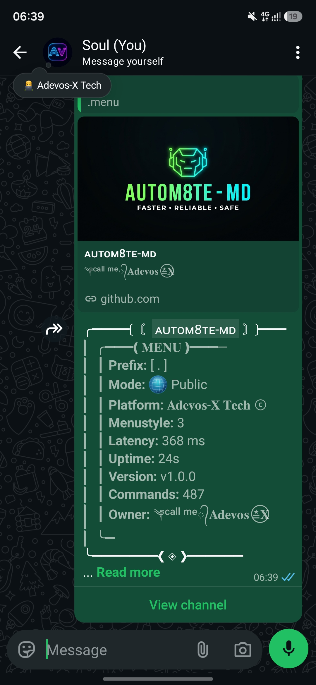
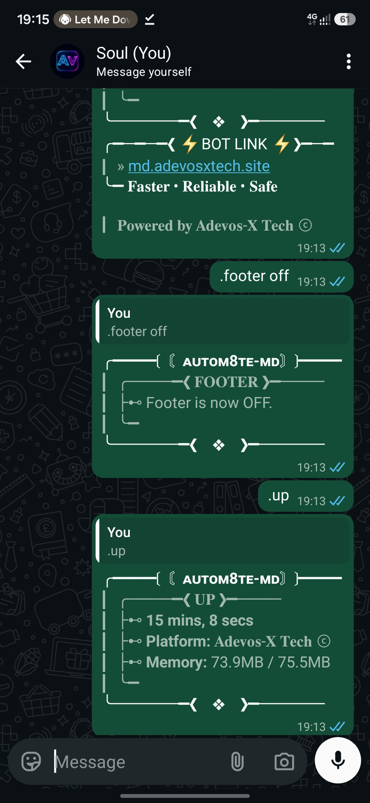

  

<h3 align="center">A WhatsApp Multi Device bot, built with Baileys and Node.js. Simple and strong.</h3>

  
  
  

  
  
  
  

---

## Get your own bot in 3 steps

| | Step | What happens |
|---|---|---|
| **1** | Open **[md.adevosxtech.site](https://md.adevosxtech.site)** and tap **Connect** | Choose a pair code or a QR code |
| **2** | Link your WhatsApp | Enter the code in *Linked devices*, or scan the QR |
| **3** | Wait a minute | Your bot is deployed for you and replies on your number |

Prefer to stay in WhatsApp? Send `.pair 2547XXXXXXXX` to any AUTOM8TE MD bot. It sends you a code, and your own bot is deployed as soon as you link.

## Features

- **Always on.** Your bot stays online around the clock, replying and acting while you are away.
- **450+ commands.** Media tools, downloaders, stickers, AI tools, games, utilities and more. Send `.menu` to see them all.
- **Protection and automation.** Status tools, group protections and owner automation commands built in.
- **Stays up to date.** Send `.update` and the bot updates itself to the latest release, keeping your WhatsApp session linked.

## Handy commands

| Command | What it does |
|---|---|
| `.menu` | Shows every command and the installed version |
| `.pair <number>` | Gets a pairing code and deploys a bot for that number |
| `.update` | Updates your bot to the latest version (shows what is new) |
| `.restart` | Restarts your bot |
| `.repo` | Links to the website, this repository and the GitHub account |
| `.tutorial` | Step by step guide and the tutorial video |

## Versions and updates

Every release has a number: `MAJOR.MINOR.PATCH`.

| Change | Example | Number goes |
|---|---|---|
| New features | new commands | `1.0.0` to `1.1.0` |
| Fixes | a command repaired | `1.0.0` to `1.0.1` |
| Big changes | settings change | `1.0.0` to `2.0.0` |

The latest version is shown in the badge at the top and in [`version.json`](version.json). Everything that changed is in the [changelog](CHANGELOG.md). Bots only change when a new release is published, so a bot never changes unexpectedly.

## Screenshots

<table>
  <tr>
    <td align="center"> The menu</td>
    <td align="center"> Update with <code>.update</code></td>
  </tr>
</table>

## Use it responsibly

WhatsApp can ban numbers that send spam or use heavy automation. Do not use broadcast or bulk commands on people who have not messaged you first, avoid unknown links and mass group joins, and use a secondary number if you are unsure.

---

<b>Powered by Adevos-X Tech</b>

